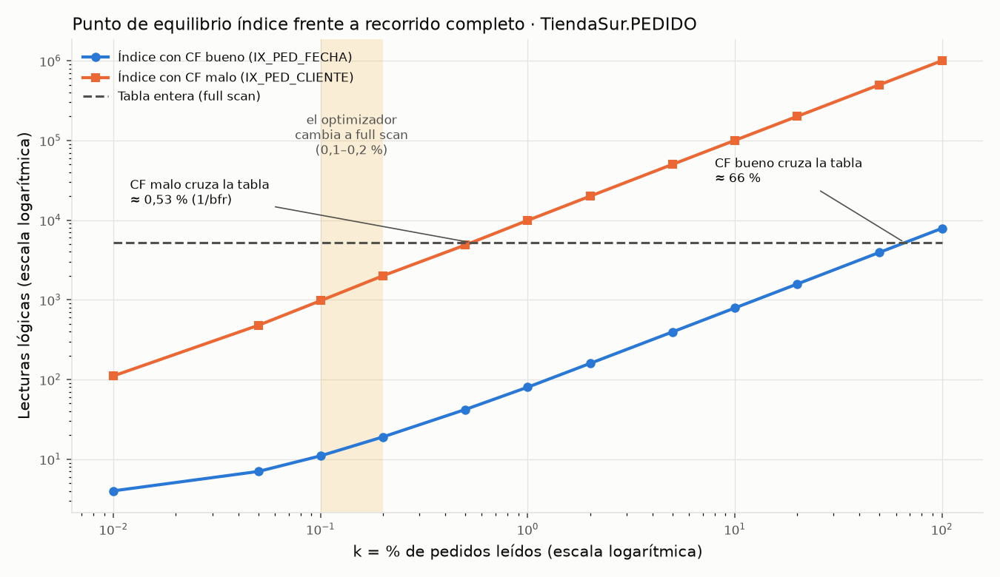

# Lab 5 — Oracle DBA Workflow II · Respuestas

> Issue: #12 · Branch: `chore/12-oracle-dba-workflow-ii`
>
> Todas las cifras salen de MI evidencia, en `docs/bitacora/lab5/evidencia/` (se cita el archivo sin la marca de
> tiempo: `script/…_02-anatomia-indice.script.log` → `02-anatomia-indice`).

## Nota sobre el punto de partida

Mi Lab 4 se hizo con el kit v1 (Partes A–J, verificación `10-verificacion-final.sh` en TODO OK, etiqueta `lab4-final`).
El Lab 5 pide `16-verificacion-final.sh` del Lab 4 v3, que no existe en mi repositorio. De las partes extra del Lab 4 v3
solo una afecta al Lab 5: el permiso de C##OPS_RO sobre `V$DIAG_ALERT_EXT` (Lab 4 v3, Parte J), que apliqué en la
Parte P con `scripts/lab4/11-ampliar-ops-ro.sql` (evidencia `15-ampliar-ops-ro`). Los scripts de `scripts/ops/` y
`deployment/env/05` y `08` se actualizaron al kit v3 en un commit propio.

Otras diferencias de mi entorno con el enunciado:

- La base ya estaba en **ARCHIVELOG** desde el Lab 3: `11-activar-archivelog` solo creó la FRA (4 GB) y no reinició.
  Los archivados anteriores a la FRA están en `$ORACLE_HOME/dbs` (`arch1_*.dbf`).
- Los grupos de redo de mi imagen son de **200 MB**, no de 20 MB (`10-redo`, sección 1).
- Las salidas de SQL*Plus del contenedor muestran `??` en lugar de las tildes (el contenedor no define `NLS_LANG`).

---

## Simulacros: RTO y RPO

| Simulacro | Qué se rompió | Cómo se recuperó | RTO medido | RPO |
|---|---|---|---|---|
| A · caída de instancia | `SHUTDOWN ABORT` con una transacción confirmada (102) y otra no (103) | `STARTUP`: SMON hace roll forward y roll back solo | ≈ 2 s (alert log: `Starting ORACLE instance` 21:38:20 → `Completed: ALTER DATABASE OPEN` 21:38:22) | 0 (102 sigue EGRESADO) |
| B · pérdida de un control file | se borró `control03.ctl` con la base parada → ORA-00205 | copiar `control01.ctl` sobre la perdida, `MOUNT`, `OPEN` | ≈ 2 s desde el ORA-205 (21:38:33 → OPEN 21:38:35) | 0 |
| C · tabla borrada con `PURGE` | `DROP TABLE aca_matriculas PURGE` | restaurar la copia en frío `lab5-pre-simulacro` (1,3 GB) | **46 s** | todo lo posterior a la copia (aquí 1 s; en la vida real, el intervalo entre copias) |
| D · pérdida de un datafile | `rm academia01.dbf` (file 26); Oracle cerró FREEPDB1 (ORA-63999) | RMAN `RESTORE` + `RECOVER DATAFILE 26`, `ONLINE`, abrir la PDB | **8 s** (9 s desde el fallo) | **0** (la fila 104, cambiada tras la copia, sigue EGRESADO) |

Fuentes: `14a-caida-instancia`, `14b-perdida-controlfile`, `14c-simulacro-restauracion`, `14d-perdida-datafile` y
el alert log.

## Retrospectiva del game day

- **Bien:** los cuatro fallos se recuperaron sin perder datos confirmados salvo en C, donde el RPO es el que marca la
  copia en frío. La multiplexación (Parte J) convirtió la pérdida de un control file en una copia de archivo de 2 s, y
  ARCHIVELOG + RMAN dejó el RPO del simulacro D en 0.
- **Lo que no esperaba:** en el simulacro D Oracle cerró la PDB entera (ORA-63999) en lugar de dejar solo el
  tablespace fuera de línea: el RTO real afecta a toda FREEPDB1, no solo a `TBS_ACADEMIA`.
- **Mejora 1:** el simulacro C tarda 46 s y pierde lo posterior a la copia; con una copia RMAN del tablespace y
  `RECOVER TABLE` (o un punto de restauración / Flashback Database) el RTO bajaría y el RPO sería casi 0.
- **Mejora 2:** las tres copias del control file y los dos miembros de redo están en el mismo volumen; en producción
  irían en discos distintos, y además activaría `CONFIGURE CONTROLFILE AUTOBACKUP ON`.
- **Mejora 3:** el runbook de pérdida de datafile (`docs/runbooks/perdida-datafile.md`) cubre los dos caminos (PDB
  abierta o cerrada).

---

## Preguntas de comprobación

### Punto de partida y banco de medida (A, B)

**1. Paso 6 de la copia lab4-final frente a lab3-final.**
En mi equipo las dos dicen lo mismo: `ninguno: el volumen contiene toda la base de datos` y
`archivos_fuera_del_volumen=0` (manifiestos de `backups/…_lab3-final` y `…_lab4-final`). La razón es que en esta imagen
`$ORACLE_HOME/dbs` es un enlace simbólico a `/opt/oracle/oradata/dbconfig/FREE/dbs`, así que los datafiles del Lab 3
ya estaban físicamente en el volumen. La diferencia está en el inventario: en lab3-final
`/opt/oracle/product/26ai/dbhomeFree/dbs/academia01.dbf` y en lab4-final
`/opt/oracle/oradata/FREE/FREEPDB1/academia01.dbf`. Demuestra que la reubicación del Lab 4 funcionó: los datafiles
ya no dependen de un enlace que una actualización de la imagen podría cambiar.

**2. bfr de CLIENTE y PEDIDO.**
`01-perfil-tiendasur`, sección 1: CLIENTE r = 100 000, b = 1517, R = 102 bytes → bfr = 100 000 / 1517 ≈ 66.
PEDIDO r = 1 000 000, b = 5320, R = 32 bytes → bfr = 188. PEDIDO cabe casi el triple (188/66 ≈ 2,85) porque su fila
es unas tres veces más corta (102/32 ≈ 3,2): el bfr depende del tamaño de fila. El reto lo confirma: los bloques de
PEDIDO tienen de 2 a 200 filas, con una media de 191,6 en los 5220 bloques con datos (`01-reto-bfr`). No todos tienen
las mismas porque las filas no miden lo mismo, el último bloque queda a medias y `BLOCKS` cuenta 100 bloques
por debajo del HWM sin filas (5320 frente a 5220).

**3. ¿Por qué se ejecuta dos veces y se mide la segunda?**
La primera ejecución incluye trabajo que no se repite: el análisis (hard parse), las lecturas físicas para traer los
bloques a la caché y la limpieza diferida de bloques. Medir la segunda da el coste "en caliente", estable y
comparable entre alternativas. La prueba de la PK da 4 lecturas lógicas y 0 físicas (`01-herramienta-medir`).

### Anatomía y tipos de índice (C, D)

**4. IX_PED_CLIENTE: altura, hojas y fan-out.**
`02-anatomia-indice`, sección 2: altura 3, 2216 hojas, 6 ramas, 1 000 000 de entradas. fo real =
(2216 + 6 − 1) / 6 = 370; fo máximo = 8028 / 14,8 = 543. Con mil millones de filas: 2 208 969 hojas → altura 4
(5 lecturas para encontrar una fila).

**5. ROWID de una entrada de la hoja de PK_CLIENTE.**
`02-anatomia-indice`, sección 4: `row#0 … data:(6): 00 00 03 1b 00 00`, clave `c1 02` (el número 1). Los 4 primeros
bytes son el bloque (0x0000031B = 795) y los 2 últimos la fila (0). La comprobación con `DBMS_ROWID` da cliente 1 en el
bloque 795, ranura 0. No aparece el número de archivo porque TBS_TIENDASUR es un tablespace **bigfile**: tiene un
único datafile, así que el ROWID de índice solo necesita bloque y ranura.

**6. Tres pruebas de la Parte D** (`03-tipos-indice`).
- **Único, Q13:** sin índice 1486 lecturas (TABLE ACCESS FULL); con `UNIQUE (dni)` 3 (INDEX UNIQUE SCAN). Además, la
  base impide el duplicado (ORA-00001).
- **Compuesto y cubriente, Q7:** con `ix_ped_cliente` 15 lecturas (más un SORT); con `(id_cliente, fecha)` 7, porque
  el índice ya está ordenado por fecha; con el cubriente 3, porque no va a la tabla.
- **Bitmap, Q14:** sin bitmaps 4073 lecturas; con 4 bitmaps 528. `BITMAP AND` combina los filtros antes de tocar la
  tabla.

### Agrupamiento, equilibrio y sargabilidad (E, F)

**7. Clustering factor.**
`04-agrupamiento-equilibrio`, sección 1: IX_PED_FECHA CF = 5220 (la tabla tiene 5320 bloques) e IX_PED_CLIENTE
CF = 999 041 (la tabla tiene 1 000 000 de filas). Los pedidos se cargaron en orden de fecha (`ORDER BY n`), así que
fechas vecinas están en bloques vecinos; el cliente se repartió al azar y casi cada entrada salta a otro bloque.
Un REBUILD **no** lo arregla: el CF es una propiedad del orden de las filas en la TABLA. Solo reordenar la tabla lo
cambia, y entonces empeoraría el del otro índice.

**8. ¿A partir de qué porcentaje deja de compensar cada índice?** (`docs/bitacora/lab5/curva-equilibrio.png`)
- Índice con CF malo (IX_PED_CLIENTE): entre 0,5 % (4875 lecturas) y 1 % (9920), frente a 5232 de la tabla. El
  cruce está en ≈ 0,53 %, exactamente 1/bfr = 1/188 de la fórmula de la Unidad 3 en lecturas lógicas.
- Índice con CF bueno (IX_PED_FECHA): ≈ 66 % (3938 lecturas al 50 % y 7875 al 100 %).
- El optimizador cambia a full scan entre 0,1 % y 0,2 %, antes que el cruce en lecturas lógicas, porque valora la
  lectura aleatoria más cara que la secuencial: con c_sec/c_aleat = 1/5 la fórmula da 0,11 %.

Los tres puntos no coinciden porque miden cosas distintas: el CF decide cuántos bloques de tabla toca el índice,
y el optimizador razona en coste de disco y no en lecturas lógicas.



**9. ¿Por qué Q4b ('Gonz%') usa el índice y lee más que un full scan?**
`05-sargabilidad`: Q4b devuelve 2056 filas con 2024 lecturas lógicas, frente a las ≈ 1486–1523 de un recorrido
completo de CLIENTE. 'Gonz%' es el 2,1 % de los clientes, por encima del punto de equilibrio de CLIENTE (1/bfr =
1/66 ≈ 1,5 %). Además, los apellidos están repartidos al azar (CF malo), así que cada fila cuesta casi un bloque
distinto: 2056 filas ≈ 2024 lecturas. El predicado es sargable, así que el optimizador puede usar el índice, pero
eso no lo hace más barato.

### Coste de escritura y mantenimiento (G, H)

**10. Bloques modificados por INSERT** (`06-indices`).
- Hoy, con 4 índices en PEDIDO: 10,2 bloques por fila.
- Propuesta del compañero, con 9 índices: 20,2.
- V005, con 5 índices: 12,1.

Cada índice suma unos 2 bloques: la hoja y su undo. De la propuesta del compañero rechacé:
- `IX_PED_CANAL`: 3 valores, el 33 % por valor, no viable (pregunta 2), y `MONITORING USAGE` = NO.
- `IX_PED_ESTADO`: el 25 % de media por valor. Lo sustituí por el índice parcial `IX_PED_PENDIENTES` (solo 'P').
- `IX_PED_FEC_CLI`: no se usó (MONITORING NO) y hacía redundante a IX_PED_FECHA.
- `IX_PED_IMPORTE`: no se usó; invisible, Q2 siguió en 335 lecturas.
- `IX_PED_CLIENTE`: es el prefijo de `IX_PED_CLI_FEC_CUB`, que también cubre la clave ajena.

**11. 50/50, 90/10 y cola** (`07a-…`, `07b-…`, `07c-…`).
- **50/50, claves al azar (IX_AZAR):** 595 divisiones, ninguna 90/10. 336 entradas por hoja (≈ 67 % de llenado,
  cerca de ln 2), y el mapa es irregular: `==-====-==#===------===…`.
- **90/10, claves crecientes (IX_CRECIENTE):** 398 divisiones, todas 90/10. 501 entradas por hoja y un mapa todo
  `#`: cada hoja que se llena se queda llena.
- **Cola (IX_COLA):** el mapa tiene la mitad izquierda vacía y la derecha llena (`[        …=####…]`).
  INDEX_STATS da un 41 % de entradas borradas, y "dame el siguiente mensaje" lee 226 bloques frente a 2.

**12. Remedio para la cola en producción, en horario de servicio.**
`ALTER INDEX … COALESCE`. Es en línea y sin bloqueo. Medido (`07c-remedios`): pasa de 425 a 201 hojas, de 68 734 a 0
entradas borradas y de 226 a 2 lecturas. No devuelve espacio (el segmento sigue en 4 MB). Si el espacio importa,
`SHRINK SPACE` (también en línea, 1,69 MB). Descarto REBUILD ONLINE porque necesita el doble de espacio y genera mucho
redo para el mismo resultado. La cura de fondo es de diseño: particionar por fecha y vaciar particiones enteras.

### SCN, control files, redo y FRA (I a L)

**13. ¿Qué compara Oracle al abrir?** (`08-scn-checkpoint`)
Compara el SCN de checkpoint de cada datafile en el control file (`v$datafile.checkpoint_change#`) con el de la
cabecera del propio archivo (`v$datafile_header`). En mi evidencia los dos valen 3216156 ("sincronizado"), y tras el
CHECKPOINT ambos pasan a 3222797. Si la cabecera fuese más antigua que el control file, haría falta recuperación de
medios; si el control file indica que la base no se cerró limpia, Oracle hace recuperación de instancia.

**14. Multiplexar el control file en el mismo volumen.**
Protege de borrar o corromper UN archivo. El simulacro B lo demuestra: se perdió `control03.ctl` y se reparó copiando
`control01.ctl` en 2 s. No protege de perder el volumen o el disco entero, porque las tres copias están en
`/opt/oracle/oradata/FREE/`. En producción cada copia iría en un disco o controlador distinto (o en grupos ASM
distintos, por ejemplo +DATA y +FRA), con `CONTROLFILE AUTOBACKUP ON` en RMAN.

**15. CURRENT, ACTIVE, INACTIVE y los tres borrados** (`10-redo`).
- **CURRENT:** LGWR escribe en él (secuencia 12 y después 13).
- **ACTIVE:** ya no se escribe en él, pero aún contiene cambios necesarios para una recuperación de instancia, porque
  sus bloques no están todos en los datafiles. Tras los dos cambios de log, los grupos 2 y 3 quedan ACTIVE.
- **INACTIVE:** ya no hace falta para la recuperación de instancia (el grupo 1, secuencia 10, al principio).

Oracle rechaza los tres borrados:
- Borrar el grupo CURRENT da ORA-01623.
- Borrar un miembro del grupo CURRENT da ORA-01609.
- Borrar otro grupo, dejando solo dos de los que uno es necesario, da ORA-01624 ("needed for crash recovery").

**16. Cadena de causas de la FRA llena** (`11-fra-llena`).
1. La FRA se encoge a 2 MB y se genera redo.
2. ARCn no puede escribir: el alert log dice `ORA-19815: … 100.00% used` y `ORA-19809: limit exceeded`.
3. `ARCHIVE LOG CURRENT` falla con `ORA-16038: log 3 sequence# 15 cannot be archived`.
4. El grupo 3 queda `ARC=NO` en estado ACTIVE, así que LGWR no puede reutilizarlo.
5. Cuando LGWR necesite ese grupo, las sesiones esperarán en "log file switch (archiving needed)" y las conexiones
   nuevas recibirán ORA-00257: la base deja de aceptar cambios.

Al devolver los 4 GB, ARCn reintenta solo: los grupos 1 y 3 pasan a `ARC=YES`.

### Undo, WAL y simulacros (M a P)

**17. "Lectores no bloquean a escritores"** (`12-lectura-consistente`, pasos 1–4).
1. A ha cambiado la fila 101 sin confirmar. B la lee y ve `ACTIVO`, el valor confirmado, reconstruido con el undo,
   sin esperar.
2. La transacción de A ocupa 1 bloque y 1 registro de undo.
3. A tiene un bloqueo TM en modo 3 sobre la tabla y un TX en modo 6 sobre la fila.
4. Solo cuando B pide bloquear la fila (`FOR UPDATE WAIT 3`) espera y recibe ORA-00054.

Una lectura normal nunca pide bloqueos de fila: ni el lector bloquea al escritor ni el escritor al lector.

**18. Undo del DELETE frente al INSERT, y redo del ROLLBACK** (`12-undo-y-redo`, 10 000 filas).
- INSERT: 140 bloques de undo (1120 KB). El undo solo guarda "borra este ROWID".
- UPDATE: 72 bloques (576 KB): los valores anteriores de las columnas cambiadas.
- DELETE: 427 bloques (3416 KB). Guarda la fila entera y sus entradas de índice, para poder reinsertarla.

El ROLLBACK también genera redo (358, 751 y 4701 KB) porque deshacer es aplicar cambios nuevos a bloques de datos y de
índice, y todo cambio de bloque se protege con redo.

Reto: la FRA pasó de 8,2 a 27 MB, es decir 18,8 MB (archivado 17, `12-reto-fra`). La suma de la columna de redo de la
tabla es ≈ 18,1 MB; la diferencia es el redo de la actividad de fondo de la instancia y las cabeceras del archivado.

**19. ¿Dónde está la durabilidad?** (`13-lgwr-dbwn`)
- **Tras el COMMIT:** 8347 KB de redo escritos por LGWR (9 escrituras) y 0 bloques escritos por DBWn. Quedan 231
  bloques sucios de la tabla en la caché. La garantía está en el redo log online.
- **Tras el CHECKPOINT:** DBWn escribe 609 bloques y los bloques sucios bajan a 0. Ahora los datos también están en
  los datafiles, y ese redo ya no hace falta para una recuperación de instancia.

**20. Simulacro A: roll forward y roll back** (`14a-caida-instancia`).
El alert log muestra `Beginning crash recovery of 1 threads`, `Recovery starting at … scn 3226567`,
`read 15 KB redo, 6 data blocks need recovery` y `Completed crash recovery`.
- **Roll forward:** SMON aplica el redo y rehace TODO, incluidos el cambio de 103 y el undo que lo describe.
- **Roll back:** con el undo deshace lo no confirmado.

Resultado: 102 = EGRESADO, porque estaba confirmado y su redo estaba en disco, y 103 = ACTIVO, porque no estaba
confirmado.

**21. RTO y RPO de los simulacros C y D.**
- **C:** RTO 46 s y RPO = todo lo hecho desde la copia en frío.
- **D:** RTO 8 s (9 desde el fallo) y RPO 0.

C restaura el volumen entero desde una copia en frío y no aplica redo: vuelve exactamente al momento de la copia. D
restaura un solo archivo desde RMAN y lo pone al día con el redo archivado y el online, gracias a ARCHIVELOG (Parte L).
D solo es posible con ARCHIVELOG y una copia del archivo; C sirve para cualquier error, incluido uno lógico como un
DROP ... PURGE.

**22. Errores ORA- del bloque 5 del runbook** (`15-healthcheck`).
- ORA-01113 (`file 31 needs media recovery`), ORA-01110 (datafile 26) y ORA-63999 (`data file suffered media
  failure`): **efecto del laboratorio**. Son la huella del simulacro D: Oracle cerró FREEPDB1 y, al reabrirla,
  comprobó las cabeceras. La PDB terminó READ WRITE y la verificación da TODO OK.
- ORA-00202 (control03.ctl) y `ORA-205 signalled during: ALTER DATABASE MOUNT`: **efecto del laboratorio**
  (simulacro B).
- ORA-00800 [Set Priority Failed] [VKTM]/[LGWR]: **ruido conocido** del contenedor (no tiene CAP_SYS_NICE), ya
  clasificado en el Lab 4.
- **Incidentes reales:** ninguno.

---

## Retos de práctica profesional

- **B · bfr con DBMS_ROWID** (`01-reto-bfr`): bloques con entre 2 y 200 filas, media 191,6 y 188 según las
  estadísticas. Explicado en la pregunta 2.
- **C · calcula antes de medir** (`02-reto-ux-cli-email`):
  - Cálculo a mano: con 30 bytes por entrada y hoja útil al 90 %, unas 100 000 × 30 / (7996 × 0,9) ≈ 417 hojas.
    Con fo = 543 bastaría una raíz: altura 2.
  - INDEX_STATS: altura **3**, 501 hojas y 3 ramas, 35,9 bytes por entrada. Las claves de email son largas también
    en las ramas: unas 500 entradas no caben en un bloque de rama, así que hace falta un nivel más. El fo de
    IX_PED_CLIENTE (clave numérica corta) no se puede trasladar a una clave larga.
  - Mapas: PK_CLIENTE está al 99,6 % (las claves llegaron en orden creciente y las divisiones 90/10 dejan las hojas
    llenas). UX_CLI_EMAIL está al 89,6 %: el índice se creó con los datos ya cargados y respeta PCTFREE 10.
- **D · índice cubriente para Q9** (`03-reto-q9`): Q9 cuesta 5 lecturas con IX_PED_FECHA. Un cubriente con todas las
  columnas sería casi una copia de PEDIDO (42 MB) para ahorrar unas 3 lecturas. **No lo pediría.**
- **E · curva:** `docs/bitacora/lab5/curva-equilibrio.png`, generada con `scripts/lab5/04-dibujar-curva.py` a partir
  de la evidencia 04. Explicada en la pregunta 8.
- **F · revisión de código** (`05-reto-revision`). Comentario que dejaría en el PR:
  > **issue (blocking):** `SUBSTR(telefono, 1, 3) = '600'` aplica una función a la columna (regla 1): no puede
  > usar un índice sobre TELEFONO. Es equivalente a `telefono LIKE '600%'`, que sí es sargable.
  > `UPPER(apellidos) = 'GIL'` también rompe la regla 1. Los apellidos se guardan con mayúscula inicial
  > ("Pérez Castro"), así que no se puede quitar el UPPER sin cambiar el resultado: necesita un índice basado en
  > función sobre `UPPER(apellidos)`. Y la búsqueda probablemente debería ser por el primer apellido, porque
  > `= 'GIL'` no encuentra "Gil Pérez".
  > Medido: rota 1487 lecturas (full scan); reescrita con `LIKE '600%' OR UPPER(apellidos) = 'GIL'` y los dos
  > índices, **722** (BITMAP OR). La variante UNION ALL no mejora (1490), porque el tramo del teléfono vuelve al
  > full scan.
- **G · defiende tu propio índice:** propuse un índice sobre `cliente(apellidos)` para Q4b ('Gonz%'), que V005 no
  cubre. Con las cifras del banco **no se crea V006**:
  - Con el índice, Q4b lee 2024 bloques frente a ≈ 1486 del recorrido completo (`05-sargabilidad`), porque el 2,1 %
    supera el punto de equilibrio de CLIENTE (≈ 1,5 %).
  - Cada INSERT de cliente pagaría unos 2 bloques más (`06-indices`, pregunta 3).
  - Solo compensaría con una consulta mucho más selectiva o paginada (las 20 primeras filas).
- **H · diagnostica sin ver el script:** **pendiente**. Depende del índice degradado que creará el profesor; el
  diagnóstico irá como comentario en la Issue #12.
- **I · MTTR bajo carga** (`08-reto-mttr`): tras el UPDATE de 20 000 filas sin checkpoint, `ACTUAL_REDO_BLKS` pasó de
  109 a 3772 y `RECOVERY_ESTIMATED_IOS` de 14 a 357. `ESTIMATED_MTTR` siguió en 44 s porque Oracle lo recalcula
  periódicamente y no al instante. Cuanto más redo hay pendiente desde el último checkpoint, más hay que aplicar
  en una recuperación de instancia y más tarda.
- **K · dimensiona el redo** (`10-reto-redo`). En la hora de la carga de TiendaSur hubo 9 cambios de log y se
  archivaron 1443 MB de redo. Para que esa carga produjera como mucho 4 cambios: 1443 / 4 ≈ 361 MB, es decir grupos
  de **400 MB**. Comandos (sin ejecutar):
  ```sql
  ALTER DATABASE ADD LOGFILE GROUP 4 ('/opt/oracle/oradata/FREE/redo04.log', '/opt/oracle/oradata/FREE/redo04b.log') SIZE 400M;
  ALTER DATABASE ADD LOGFILE GROUP 5 ('/opt/oracle/oradata/FREE/redo05.log', '/opt/oracle/oradata/FREE/redo05b.log') SIZE 400M;
  ALTER DATABASE ADD LOGFILE GROUP 6 ('/opt/oracle/oradata/FREE/redo06.log', '/opt/oracle/oradata/FREE/redo06b.log') SIZE 400M;
  -- cambiar de log hasta que los grupos 1-3 queden INACTIVE (y archivados)
  ALTER SYSTEM SWITCH LOGFILE;  ALTER SYSTEM CHECKPOINT;   -- repetir y comprobar v$log
  ALTER DATABASE DROP LOGFILE GROUP 1;
  ALTER DATABASE DROP LOGFILE GROUP 2;
  ALTER DATABASE DROP LOGFILE GROUP 3;
  -- y borrar los archivos viejos del sistema de archivos (Oracle no lo hace si no son OMF)
  ```
- **M · coste de un DELETE en la FRA:** explicado en la pregunta 18.
- **O · runbook del simulacro D:** `docs/runbooks/perdida-datafile.md`.
- **P · umbral de alerta** (`15-reto-alerta`, ejecutado como C##OPS_RO): devuelve una fila solo si la FRA supera el
  85 % o no hay copias RMAN completadas en 24 h. Hoy devuelve 0 filas: FRA al 1,9 % y una copia RMAN.

---

## Preguntas tipo examen de cada Parte

| # | Respuesta | Justificación (y dónde lo comprobé) |
|---|---|---|
| B1 | **B** | E-Rows tan lejos de A-Rows en una columna sesgada indica que falta un histograma. Con FREQUENCY, Oracle sabe que 'P' es el 2 % (B, `01-perfil-tiendasur`). |
| C1 | **C** | BLEVEL 2 = altura 3: 3 bloques de índice + 1 de tabla = 4, como la PK de PEDIDO (C, `02-anatomia-indice`). |
| C2 | **C** | 2 000 000 de hojas / 500 = 4000 ramas → / 500 = 8 → 1 raíz: 3 niveles de rama + hojas = altura 4. |
| D1 | **B** | Pocos valores, carga nocturna y filtros combinados: bitmaps combinados con BITMAP AND (D, Q14: 4073 → 528). |
| D2 | **A, C** | Evita ir a la tabla (Q7 cubriente: 3 lecturas) y encarece las escrituras; en Oracle no existe INCLUDE (D). |
| E1 | **B** | CF ≈ filas → un bloque por fila; el 3 % supera 1/bfr = 1/125 = 0,8 %: recorrido completo (E). |
| F1 | **B** | Comparar VARCHAR2 con un número añade TO_NUMBER sobre la columna (F, Q3: 5232 → 106). |
| F2 | **A, C** | Dos rangos sobre la columna desnuda, equivalentes a "ese día". B solo encuentra la medianoche (F, Q11). |
| G1 | **B** | INVISIBLE: Oracle lo sigue manteniendo, el optimizador lo ignora y se revierte al instante (G, pregunta 5). |
| G2 | **B** | Cada índice suma unos 2 bloques por INSERT: 500 × 2 ≈ 1000 por segundo (G: 10,2 → 12,1 → 20,2). |
| H1 | **B** | COALESCE fusiona las hojas vacías de la izquierda en línea (H: 226 → 2 lecturas). |
| H2 | **A, C** | Reparte la hoja caliente, pero rompe los rangos (H: 30 frente a 878 lecturas y full scan). |
| I1 | **B** | SCN de checkpoint del control file frente al de la cabecera (I, `08-scn-checkpoint`). |
| J1 | **B** | Oracle escribe en todas las copias: si una falla, la instancia se detiene; se sustituye la copia y se arranca (J y O-B). |
| J2 | **A, C** | Estructura física (datafiles y redo) y SCN de checkpoint. Los parámetros están en el SPFILE (J). |
| K1 | **C** | ACTIVE = aún necesario para la recuperación de instancia (K: ORA-01624 al intentar dejar uno solo). |
| L1 | **B** | Primero el tamaño y después la ruta: ORA-19802 en mi evidencia 11. |
| L2 | **A, C** | Dar espacio a la FRA (L: 2 MB → 4 GB y ARCn reintenta) o hacer copia y borrar los archivados con RMAN. Nunca con rm. |
| M1 | **C** | Lectura consistente con el undo (M, paso 1: B ve ACTIVO). |
| M2 | **C** | DELETE: 3416 KB de undo frente a 1120 (INSERT) y 576 (UPDATE) (M). |
| M3 | **B, D** | Más retención y tamaño de undo, y RETENTION GUARANTEE si el informe es crítico. |
| N1 | **A** | COMMIT = redo en el redo log online (N: 8347 KB de redo y 0 bloques de DBWn). |
| N2 | **B, C** | Checkpoint (N: 609 bloques) y falta de buffers libres; no en cada COMMIT. |
| O1 | **B** | Recuperación de instancia automática (O-A: 102 sobrevive y 103 se deshace). |
| O2 | **B, D** | Copiar una copia sana (lo que hice en O-B) o quitar la perdida de CONTROL_FILES. |
| O3 | **B** | OFFLINE, RESTORE, RECOVER, ONLINE (O-D; en mi caso Oracle cerró la PDB y además hubo que abrirla). |

## Simulacro de examen 1Z0-182

| # | Respuesta | Justificación · Parte donde lo comprobé |
|---|---|---|
| S1 | **B** | CF ≈ filas: casi un bloque distinto por fila · E (IX_PED_CLIENTE, CF 999 041). |
| S2 | **A, C** | Índice funcional (D, Q1: 1486 → 4) o comparar la columna desnuda con el valor normalizado (F, regla 1). |
| S3 | **B** | TO_NUMBER implícito sobre la columna · F, regla 3 (5232 → 106). |
| S4 | **B** | Pocos valores en un almacén de datos de solo lectura diurna · D, Q14. |
| S5 | **B** | INDEX SKIP SCAN · D, Q6 "solo ciudad" (144 lecturas). |
| S6 | **B** | INVISIBLE y observar · G, pregunta 5. |
| S7 | **A, C** | COALESCE y SHRINK SPACE, los dos en línea · H (`07c-remedios`). |
| S8 | **B** | Reparte las inserciones pero rompe los rangos · H (878 frente a 30 lecturas). |
| S9 | **C** | Un UPDATE de una columna no indexada no toca ningún índice · G (UPDATE estado: 2 bloques por fila "hoy", sin índice en estado; 6 con el IX_PED_ESTADO del compañero). |
| S10 | **B** | El fan-out, que depende del tamaño de la clave · C, reto UX_CLI_EMAIL (altura 3 frente a 2 de PK_CLIENTE). |
| S11 | **A, C** | Las filas viven en el índice de la PK; la búsqueda no va a otro segmento · D, Q15 IOT (3 frente a 4 lecturas). |
| S12 | **B** | SCN del control file frente al de la cabecera · I. |
| S13 | **C** | CKPT actualiza control file y cabeceras; DBWn escribe los bloques · I y N. |
| S14 | **B, E** | En NOMOUNT responden v$instance y v$parameter; v$database y v$logfile necesitan MOUNT · Lab 4 Parte E. |
| S15 | **B** | SHUTDOWN IMMEDIATE, STARTUP MOUNT, ARCHIVELOG, OPEN · L (script 11, rama NOARCHIVELOG). |
| S16 | **B** | CLEAR LOGFILE recrea un grupo INACTIVE ya archivado · K. |
| S17 | **A, C** | Lectura consistente y flashback query · M (pasos 1 y 6). |
| S18 | **B** | El undo vive en bloques que pueden perderse: se protegen con redo · M ("del cual describe el undo"). |
| S19 | **A** | El redo está en el redo log online · N. |
| S20 | **A** | Checkpoints incrementales más frecuentes y recuperación más rápida · I (reto MTTR). |
| S21 | **B** | ARCn no puede archivar (FRA llena) · L (`11-fra-llena`). |
| S22 | **B** | Poner el datafile OFFLINE para aislar el fallo · O-D. |
| S23 | **B** | SYSTEM no puede estar offline con la base abierta: MOUNT, RESTORE, RECOVER, OPEN · O-D (por analogía). |
| S24 | **B** | Sin redo archivado solo queda la copia en frío · O-C (RPO = intervalo desde la copia). |
| S25 | **B, D** | Más retención y tamaño de undo, y RETENTION GUARANTEE · M (`undo_retention` 900). |
| S26 | **A** | V$RECOVERY_AREA_USAGE · L (`11-activar-archivelog`, sección 5). |
